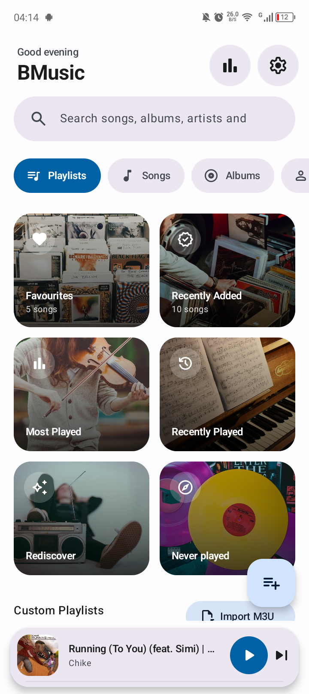
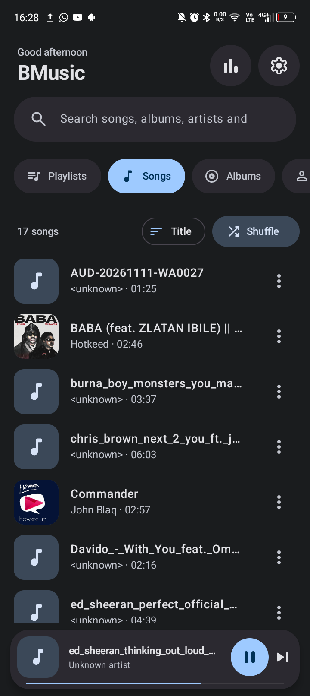
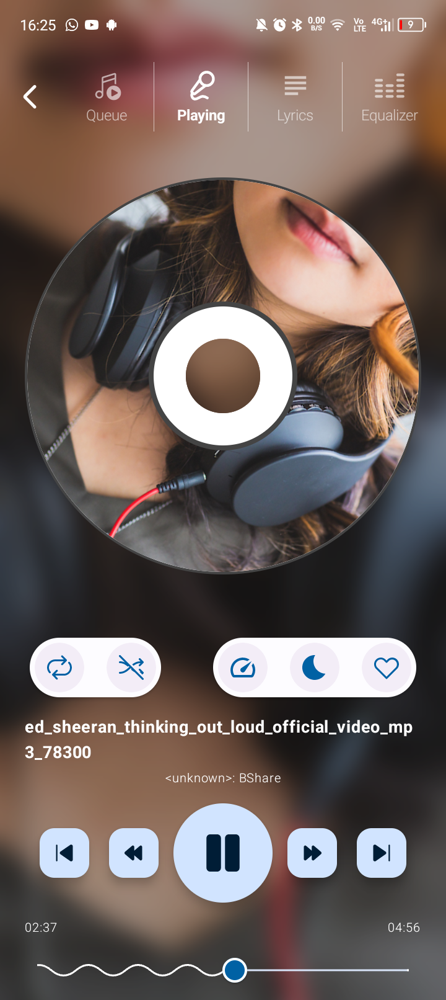
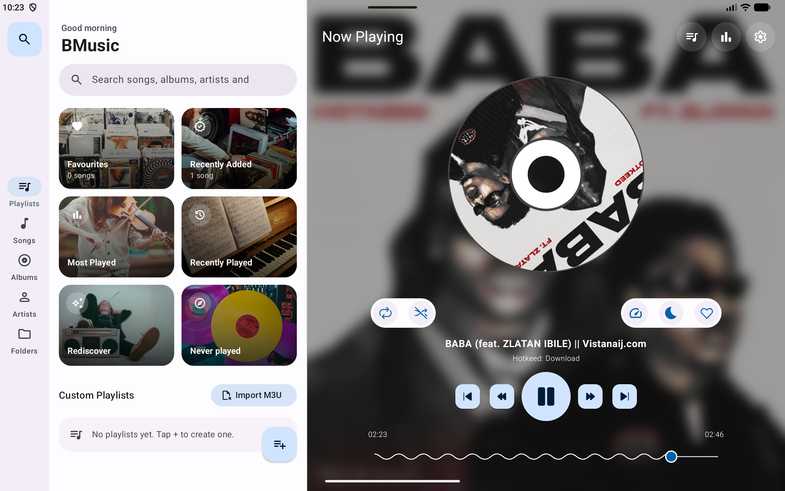

# BMusic

BMusic is an offline music player for Android, written in Kotlin with Jetpack Compose and
Media3. It plays the music already on your phone, with a phone layout and a separate tablet
layout. It has no ads, no account and no internet permission.

<p align="center">
  
  &nbsp;
  
  &nbsp;
  
</p>

<p align="center">
  
</p>

## Features

### Library
- **Five tabs:** Playlists, Songs, Albums, Artists and Folders.
- **Built-in playlists:** Favourites, Recently added, Most played and Recently played.
- **Smart playlists:** Rediscover (songs you loved but haven't played in a month) and Never played.
- **Custom playlists:** create, rename, reorder by drag, add songs, multi-select, and import
  from **M3U** files.
- **Song sorting:** by title, artist, album, recently added or length. The choice is remembered.
- **Folders tab:** browse by storage folder and play a whole folder.
- **Global search:** finds songs, albums, artists and playlists, with filter chips,
  highlighted matches and recent searches.
- **One song menu everywhere:** play next, add to queue, favourite, add to playlist, go to album
  or artist, share the audio file, and edit tags.
- **Tag editor:** writes title, artist, album and other tags back into the audio file.

### Playback
- **Background playback** with notification, lock-screen and headset controls. The
  notification adds Favourite and Shuffle buttons.
- **Queue:** reorder by the drag handle, remove songs, clear the queue, or save it as a playlist.
- **Shuffle and repeat** without stutter. The queue and position are restored after a restart.
- **Song transitions:** Off, Fade or a true Crossfade (1–12 s), with an option to keep albums gapless.
- **Gapless playback** and a playback speed setting that is remembered.
- **Sleep timer:** 15–90 minutes or "end of song", with a gentle fade-out.
- **Volume levelling (ReplayGain):** per song or per album.
- **Equalizer** with presets and custom bands, plus Bass boost, Surround and Loudness boost on
  rotary knobs.
- **Lyrics:** synced or plain. They come from imported `.lrc` files, or are read from the
  file's own tags (MP3, FLAC, Ogg/Opus, M4A).
- **Shake to change song:** an optional setting that skips to the next song.
- **Open with BMusic:** play a music file straight from a file manager, a download or a chat
  app.

### Everywhere else
- **Listening stats:** total time, plays, top songs, top artists and an activity chart (7 days,
  30 days or all time).
- **Home-screen widget:** a "Now playing" widget with artwork and controls.
- **Android Auto and Assistant:** browse Songs, Albums, Artists and Playlists, and search by voice.
- **System "resume" card:** after a reboot, the system media controls can pick up where you
  stopped.
- **Backup and restore:** playlists, favourites, stats, settings and imported lyrics, saved to a
  JSON file you choose.
- **Appearance:** light and dark themes that follow the system, and an accent colour. Pick
  "Match wallpaper" (Material You, Android 12+) or a colour swatch.
- **Five languages:** English, Spanish, French, Japanese and Chinese, switchable inside the app.
- **Tablets:** landscape layout with a navigation rail, a phone-sized library section, and a
  player that is always on screen. Queue, Lyrics and Equalizer open in a slide-over panel.
- **Accessibility:** TalkBack labels, headings, a spoken seek position, text that grows with
  font size, and reduced motion.
- **Keyboard shortcuts:** play/pause, next, previous, seek and search, for tablets and
  Chromebooks.
- **Private crash reports:** the last crash is stored on the device and only sent if you share it.

## Architecture

BMusic is a single-activity app built on **MVVM** with a unidirectional data flow:

```
Compose UI (screens, pages, components)
        │  events ↓            ↑ StateFlow
ViewModels (Hilt, one per feature)
        │
Repositories ─── Room (playlists, favourites, play counts, listening history)
        │    ├── DataStore (settings, equalizer, playback snapshot)
        │    └── MediaStore (the music library)
        │
MediaController ⇄ PlaybackService (Media3 MediaLibraryService + ExoPlayer)
```

- **UI:** Jetpack Compose with Material 3. Navigation uses **Navigation 3**. The back stacks are
  saved, so they survive rotation, language changes and process death.
  - Phones have one back stack.
  - Tablets have two, one for the library section and one for the player side.
  - `utils/Panes.kt` moves screens between them when the window size changes.
- **State:** each ViewModel exposes `StateFlow`s that the screens collect with
  `collectAsStateWithLifecycle`.
- **Playback:** a **Media3 `MediaLibraryService`** owns the player, so it keeps running without
  the UI.
  - The app talks to it through a `MediaController`, like the notification, Android Auto and the
    widget do.
  - The service owns the sleep timer, audio effects, crossfade, ReplayGain and the queue snapshot.
- **Dependency injection:** **Hilt** (`modules/`) provides the database, DataStores, repositories,
  dispatchers and service dependencies.
- **Persistence:**
  - **Room** (version 4, with tested migrations) stores user data.
  - **Proto/Preferences DataStore** stores settings and playback state.
  - The library itself is always read live from MediaStore.
- **Testable core:** logic such as shuffle order, sleep timer, transitions, lyrics parsing, M3U
  matching, folder trees, crash formatting and the tablet routing is plain Kotlin.
  - It is covered by 47 JVM unit test files (JUnit, MockK, Turbine).
  - Compose UI tests live in `androidTest`.
- **Performance:** a **Baseline Profile** (`:baselineprofile` module), R8 shrinking, a Compose
  stability config and down-sampled artwork decoding.

### Modules and packages

| Path | What it holds |
|---|---|
| `app/` | The application |
| `recordable/` | A small drag-to-reorder library for lazy lists (queue and playlists) |
| `baselineprofile/` | Baseline Profile generator and startup benchmarks |
| `app/.../ui` | `Main.kt` (navigation and layouts), plus `screens/`, `pages/`, `components/` and `theme/` |
| `app/.../viewmodels` | One ViewModel per feature (playing, songs, search, settings, stats, …) |
| `app/.../services` | `PlaybackService`, the player wrapper, crossfade engine and shake detector |
| `app/.../data` | Room entities/DAOs, repositories, DataStores, lyrics, tags, backup and playback logic |
| `app/.../modules` | Hilt modules |
| `app/.../widget` | The home-screen widget |
| `docs/` | Design and change notes for each development phase |

### Main libraries

Kotlin 2.4, Jetpack Compose (BOM 2026.08) with Material 3 1.5, Navigation 3, Media3 1.11
(ExoPlayer and Session), Room 2.8, DataStore 1.2, Hilt 2.60, kotlinx.serialization, AndroidX
Lifecycle and the Baseline Profile and ProfileInstaller libraries.
[jaudiotagger](https://bitbucket.org/ijabz/jaudiotagger) (LGPL 2.1) is used unmodified for tag
editing.

## Android APIs used

| API | Used for |
|---|---|
| **MediaStore** (`MediaStore.Audio`, `ContentResolver`) | Reading the music library, albums, artists and folders |
| **`MediaStore.createWriteRequest`** | Asking the user's permission before the tag editor writes to a file (Android 11+) |
| **Media3 `MediaLibraryService` / `MediaSession`** | Background playback, the media notification, lock screen, Android Auto, Assistant and Bluetooth controls |
| **Media3 ExoPlayer** | Decoding and playback, gapless audio, speed and audio focus |
| **`MediaButtonReceiver` and playback resumption** | Headset buttons and the system "resume" card |
| **Foreground service** (`mediaPlayback` type) and **`WAKE_LOCK`** | Keeping playback alive with the screen off |
| **`android.media.audiofx`** (`Equalizer`, `BassBoost`, `Virtualizer`, `LoudnessEnhancer`) | Equalizer and sound effects on the player's audio session |
| **`MediaMetadataRetriever`** | Embedded artwork and tags |
| **Runtime permissions** (`READ_MEDIA_AUDIO`, or `READ_EXTERNAL_STORAGE` on Android 12 and below, and `POST_NOTIFICATIONS`) | Library access and the playback notification |
| **Storage Access Framework** (`OpenDocument`, `CreateDocument`) | Importing `.lrc` and M3U files; writing and reading backups |
| **Intent filters** (`ACTION_VIEW` for `audio/*`) | "Open with BMusic" |
| **`ACTION_SEND` with URI grants** | Sharing audio files and crash reports |
| **`AppWidgetProvider`** | The "Now playing" home-screen widget |
| **`SensorManager`** (accelerometer) | Shake to skip |
| **Per-app language** (`AppCompatDelegate.setApplicationLocales`, `localeConfig`) | In-app language switching that also shows in system settings |
| **Dynamic colour** (Material You, Android 12+) | Wallpaper-based theme colours |
| **Window size classes and `ActivityInfo` orientation** | Phone portrait and tablet landscape layouts |
| **Auto Backup** (`dataExtractionRules`) | Including settings and playlists in Android device backups |
| **Baseline Profiles / ProfileInstaller** | Faster first launch and scrolling |

## Getting started

### Requirements
- **Android Studio:** a recent release that supports **Android Gradle Plugin 9.4**.
- **JDK 21:** the Gradle daemon asks for a Java 21 toolchain. Android Studio's bundled JDK works.
- **Android SDK:** Platform **37** (install it from *SDK Manager*).
- **Device:** an Android phone, tablet or emulator running **Android 8.0 (API 26)** or newer,
  with some music on it.

### Run from Android Studio
1. Clone the repository:
   ```bash
   git clone https://github.com/Bobby-TechRepo/BMusic.git
   ```
2. In Android Studio, choose **File › Open** and select the `BMusic` folder.
3. Wait for the Gradle sync to finish. If Studio asks, install the missing SDK platform or
   build tools.
4. Connect a device with USB debugging on, or start an emulator.
5. Pick the **app** run configuration and press **Run ▶**.
6. On first launch, allow access to music and notifications.
   - On an emulator, drag a few audio files onto it first. They land in *Downloads* and show up
     in the library.

### Run from the command line

Use `gradlew.bat` on Windows and `./gradlew` on macOS or Linux.

```bash
# Build and install a debug build on the connected device
./gradlew :app:installDebug

# Build a debug APK only (app/build/outputs/apk/debug/)
./gradlew :app:assembleDebug

# JVM unit tests
./gradlew :app:testDebugUnitTest

# Device UI tests (needs a connected device or emulator)
./gradlew :app:connectedDebugAndroidTest

# Lint
./gradlew :app:lintDebug
```

### Release builds
- **Signing:** release builds are minified with R8. They are signed from `keystore.properties`
  or from CI secrets. Copy `keystore.properties.example` to `keystore.properties` and fill it
  in, then run `./gradlew :app:bundleRelease`.
- **More detail:** [docs/RELEASE.md](docs/RELEASE.md) covers creating the upload key, CI
  signing, the lint baseline and regenerating the Baseline Profile.

## Privacy

BMusic has no internet permission and collects no data. See [docs/PRIVACY.md](docs/PRIVACY.md).
